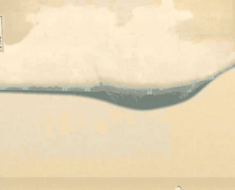
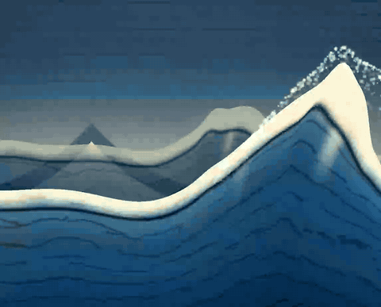

# Living Ukiyo-e

**English** · [简体中文](README.zh-CN.md) · [日本語](README.ja.md)



Hokusai’s Great Wave, gently set in motion. Shape the rhythm of the waves, clouds and sea spray, then share your own scene with a link. Everything runs in your browser, without an account or server. The GIF above starts with the print folded closed, shows the full layer-by-layer entrance, then settles into the steady 28-second loop — the same sequence a fresh visit plays.

[Live Demo · Cloveread Radio](https://cloveread.com/radio/) · **Wave Lab:** standalone local playground.

## Five stages of the wave



The Wave Lab carries the whole creation history as five selectable versions (dropdown at the top of the panel). Each one is a faithful restoration of its real source, not a re-rendering:

1. **V1 · Procedural 3D waves** — the first Radio theme (commit `1ee33a5`): a fully procedural displaced-mesh great wave with GPU spray; no artwork textures, a deterministic ambient spectrum fallback.
2. **V2 · Travelling crests** (commit `7ad5464`): crests travel and live through build → peak → break → settle, with foam, spray and highlights bound to the same crest; driven by the macro motion director.
3. **V3 · Hand-drawn 2D wave** (commit `a2973be`): five flat 2D sea bands plus a Canvas-painted hand-drawn main wave, kept still at the art-confirmation gate.
4. **V4 · Print + experiment layers** — the frozen Wave Lab as migrated into Radio (`d1f38f6`): the original print plates with the experimental layers (sea wash, calm far/mid/near waves, original flecks, inscription) stacked on top, each an independent toggle.
5. **V5 · Final artwork** — the current Radio Ukiyo-e theme: only the confirmed layer set plus the print's own cartouche, signature and seal (restored after the Owner decision on 2026-11-10), pigment-box framing, warm paper, a playback-gated 28-second loop and the part-by-part entrance with the paper opening.

V1–V4 are historical exhibits: they play, pause, replay and record, but they do not pretend to be finished works. V5 keeps the complete creative controls. Every version keeps its own state; share links carry the version identity and old (pre-version) links restore V4 exactly.

## Run locally

Node.js 24 and pnpm 11.1.2. From this directory:

```sh
pnpm install --frozen-lockfile
pnpm dev
```

Open `http://127.0.0.1:4177/`. Source changes rebuild automatically; refresh to see them. This directory owns its dependencies and lockfile.

```sh
pnpm build
pnpm check
pnpm test
pnpm exec playwright install chromium
pnpm e2e
```

E2E exercises the real `/living_ukiyoe/` project path. [Engineering notes](ENGINEERING.md) cover manual path previews, GPU measurements and rebuilding the README animation.

## What you can change

- Individual layers, waves, three boats, Mount Fuji and the inscription.
- Wave speed, forward motion, swell and layer timing.
- Blue ink patterns, six cloud regions, sea spray, composition and playback.

The floating button on the panel edge collapses the panel to that button alone (click it again to bring the panel back); on phones the panel sits below the artwork. EN / 中文 / 日本語 follow your browser until you choose one. Share opens a menu of the usual networks — X, Weibo, Facebook, Telegram, email — plus copy link, and the system share sheet where the browser has one; the [versioned fragment](SHARING.md) restores your creation. Reduced motion and a complete still fallback are supported.

## How it works

Three.js animates registered transparent pigment plates in one coordinate system, with a deterministic 28-second loop. The accepted scene and textures are protected by a [visual baseline](evidence/baseline/manifest.json); the public interface calls the original renderer. No Cloveread runtime, artwork API or online AI is required.

## Making-of

<!-- Add the real Cloveread Stories article URL here after publication. -->
The making-of article will be linked here when published.

## Credits / Assets / Licenses

Katsushika Hokusai, *Under the Wave off Kanagawa*, ca. 1830–32. [The Metropolitan Museum of Art · JP2569](https://www.metmuseum.org/art/collection/search/39799) · [Public Domain museum scan](https://images.metmuseum.org/CRDImages/as/original/DP141042.jpg). The scene uses a third-party [vector trace and drawing process](https://wp270302.wpx.jp/Hokusai/drawing-process.html).

Project code: [MIT](LICENSE), © 2026 AlloVince. Three.js (MIT), esbuild (MIT), Playwright (Apache-2.0), pngjs (MIT): [complete notices](licenses/). Artwork and derived media: [provenance](ASSETS.md), [hashed inventory](assets/provenance.json).
