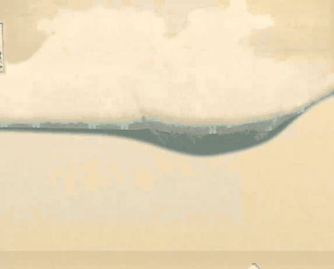
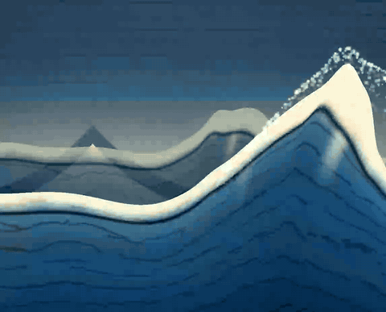

# 活的浮世绘

[English](README.md) · **简体中文** · [日本語](README.ja.md)



让葛饰北斋的《神奈川冲浪里》轻轻动起来。你可以调整海浪、云层与飞沫的节奏，再通过链接分享自己的画面。所有内容都在浏览器本地运行，无需账号或服务器。上方 GIF 从收起的纸面开始，展示完整的逐层展开过程，随后进入稳定的 28 秒循环——这正是首次访问时播放的效果。

[在线演示 · Cloveread Radio](https://cloveread.com/radio/) · **Wave Lab：**可在本地运行的独立实验场。

## 海浪的五个阶段



Wave Lab 保留了完整的创作演进过程，共有五个可切换版本（位于控制面板顶部的下拉菜单）。每个版本都忠实恢复其真实来源，而不是重新渲染出来的仿制品：

1. **V1 · 程序生成的 3D 海浪**——最初的 Radio 主题（提交 1ee33a5）：完全由程序生成的位移网格巨浪和 GPU 飞沫；不使用版画素材纹理，并带有确定性的环境频谱回退效果。
2. **V2 · 行进中的浪峰**（提交 7ad5464）：浪峰经历生成 → 隆起 → 破碎 → 平复的完整过程；泡沫、飞沫和高光都跟随同一个浪峰，由宏观运动控制器驱动。
3. **V3 · 手绘 2D 海浪**（提交 a2973be）：五层平面 2D 海面，加上一条通过 Canvas 绘制的手绘主浪；在艺术方向确认节点保持静止。
4. **V4 · 版画与实验图层**——冻结后的 Wave Lab 迁入 Radio 时的版本（d1f38f6）：原始版画图层上叠加实验图层，包括海面底色、远／中／近处的平缓海浪、原画飞沫和题字；每层都可以独立开关。
5. **V5 · 最终作品**——当前 Radio 中的浮世绘主题：只保留已确认的图层，并恢复版画原有的题签、落款和印章（依据 Owner 于 2026-11-10 作出的决定）；采用颜料盒式画框构图、暖色纸张、播放后启动的 28 秒循环，以及伴随纸面展开的逐层入场动画。

V1–V4 是历史展示版本：可以播放、暂停、重新播放和录制，但它们并不假装自己是已经完成的作品。V5 保留完整的创作控制能力。每个版本都有独立状态；分享链接会保存版本身份，早期尚未引入版本机制的链接则会准确恢复 V4。

## 本地运行

需要 Node.js 24 和 pnpm 11.1.2。在本目录中执行：

```sh
pnpm install --frozen-lockfile
pnpm dev
```

打开 `http://127.0.0.1:4177/`。修改源码后会自动重新构建，刷新页面即可查看。这是一个独立工作区，依赖和锁文件都由本目录管理。

```sh
pnpm build
pnpm check
pnpm test
pnpm exec playwright install chromium
pnpm e2e
```

E2E 会在真实的 `/living_ukiyoe/` 项目路径下测试。[工程说明](ENGINEERING.md)介绍了手动路径预览、GPU 测量，以及如何重新生成 README 动图。

## 可以调整什么

- 各个图层、海浪、三艘船、富士山和题字。
- 海浪速度、前进幅度、涌动强度和图层时序。
- 蓝色墨纹、六个云层区域、海面飞沫、画面构图和播放状态。

侧栏边缘的悬浮按钮可把面板收到只剩这个按钮，再点一次即可展开；在手机上，控制面板会排在画面下方。界面默认跟随浏览器语言，可切换 English、中文和日本語。分享会打开常用社交网络菜单（X、微博、Facebook、Telegram、邮件）与复制链接，浏览器支持时还保留系统分享面板；[版本化片段协议](SHARING.md)可以恢复你的创作。项目支持减少动态效果偏好，并提供完整的静态画面回退。

## 实现方式

Three.js 在统一坐标系中驱动已注册的透明颜料图层，并使用确定性的 28 秒循环。已确认的场景与纹理由[视觉基线](evidence/baseline/manifest.json)保护；公开界面直接调用原有渲染器。运行时不依赖 Cloveread、作品 API 或在线 AI。

## 制作过程

<!-- 正式发布 Stories 文章后，在此添加真实链接。 -->
制作过程文章将在正式发布后添加链接。

## 署名 / 素材 / 许可

葛饰北斋，《神奈川冲浪里》（*Under the Wave off Kanagawa*），约 1830–1832 年。来源：[大都会艺术博物馆 · JP2569](https://www.metmuseum.org/art/collection/search/39799) · [博物馆公有领域扫描件](https://images.metmuseum.org/CRDImages/as/original/DP141042.jpg)。画面使用第三方[矢量描摹及绘制过程](https://wp270302.wpx.jp/Hokusai/drawing-process.html)。

项目代码采用 [MIT 许可](LICENSE)，© 2026 AlloVince。Three.js（MIT）、esbuild（MIT）、Playwright（Apache-2.0）、pngjs（MIT）：见[完整第三方许可声明](licenses/)。作品及衍生素材见[来源记录](ASSETS.md)和[带哈希的素材清单](assets/provenance.json)。
